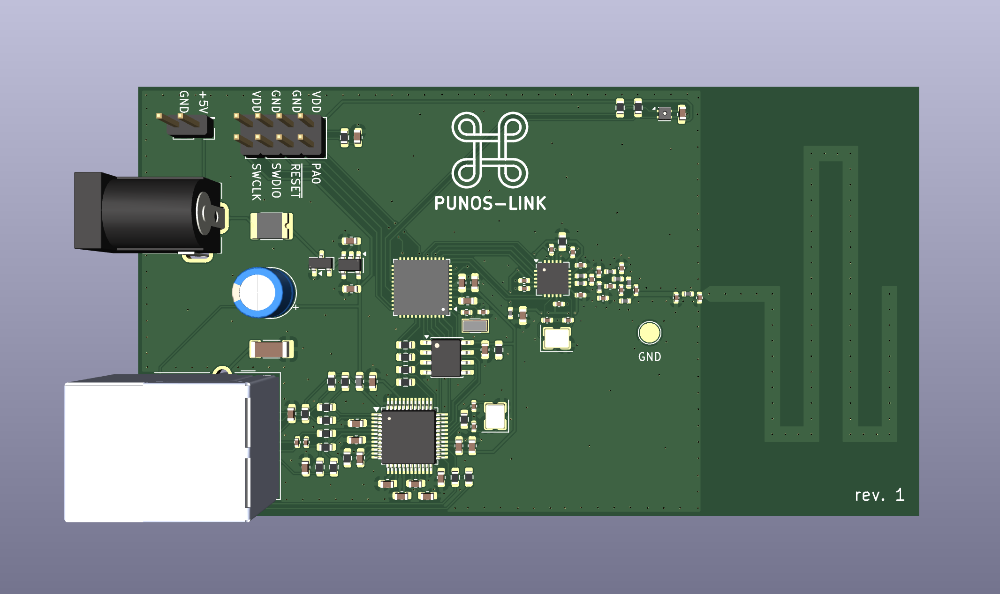

# punos-link

Punos-link publishes data from punos devices to MQTT over Ethernet.

Features:
- MCU: STM32G071
- Connectivity: TI CC1101 + 868 MHz trace antenna
- Ethernet: WizNet W5500, Hanrun HR911105A
- Temperature & humidity sensor: Sensirion SHT40
- External flash: 512 KB SPI NOR (for firmware updates over Ethernet)
- Power: 5V / 300 mA

KiCanvas:
- [View schematic](https://kicanvas.org/?repo=https%3A%2F%2Fgithub.com%2Fakheron%2Fpunos%2Fblob%2Fmain%2Fhardware%2Fpunos-link%2Fpunos-link.kicad_sch)
- [View PCB](https://kicanvas.org/?repo=https%3A%2F%2Fgithub.com%2Fakheron%2Fpunos%2Fblob%2Fmain%2Fhardware%2Fpunos-link%2Fpunos-link.kicad_pcb)

License: [CERN-OHL-P](LICENSE.txt), except [CC BY-SA](LICENSE-3RD-PARTY.md) for files in [lib/3dmodels/](lib/3dmodels/).
